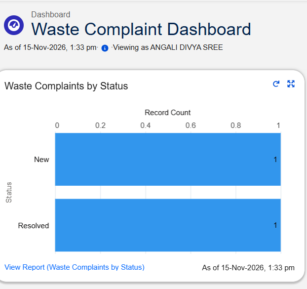

# Waste Complaint Management (GreenTrack Lite)

A Salesforce application that manages waste complaints from registration to resolution.

## Features
- **Custom object:** Waste Complaint (`Waste_Complaint__c`) with fields for complaint type, description, location, severity, status, reported date, resident email and resolution date
- **Record-triggered flows:** GreenTrack Complaint Assignment Flow and GreenTrack Reported Date Flow
- **Apex trigger:** `WasteComplaintTrigger` stamps the resolution date when a complaint is marked Resolved
- **Apex test class:** `WasteComplaintTriggerTest`
- **Report:** Waste Complaints by Status
- **Dashboard:** Waste Complaint Dashboard

## Screenshots

## Deploy to another org
sf project deploy start --manifest manifest/package.xml --target-org <alias>